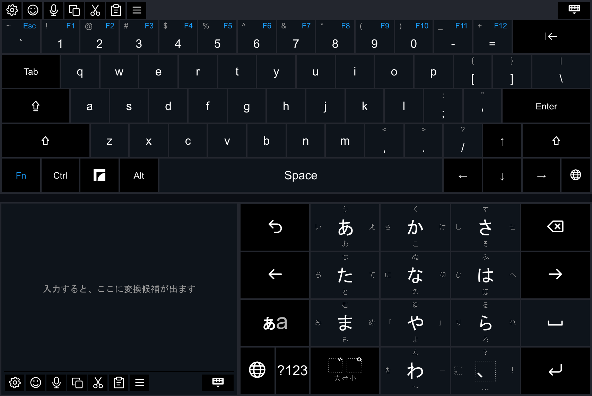
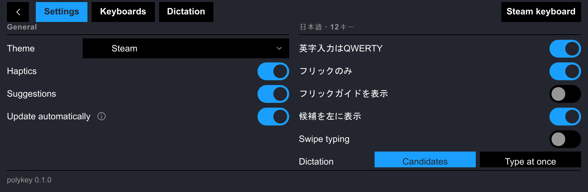
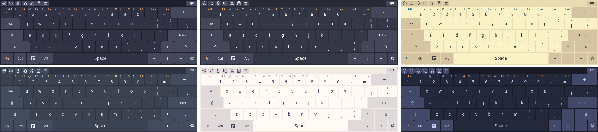

# polykey

An on-screen keyboard for the Valve Steam Frame, with English and Japanese keyboards, swipe typing and offline dictation. It draws inside Steam's own keyboard popup and sends text through Steam's own key entry point, so it works wherever Steam's keyboard appears.

> **Unofficial; not affiliated with Valve.** It relies on private Steam internals. When a required Steam object is missing, it does nothing and leaves the stock keyboard alone.



## Install

In Desktop Mode, open Konsole and run:

```sh
curl -fsSL https://github.com/Malorn44/steam-frame-polykey/releases/latest/download/install.sh | sh
```

It installs the latest release into `~/.local/share/polykey/` and starts polykey now and at every login. No sudo.

**What it needs:** Python 3.10.12+ with aiohttp, both in SteamOS, and Steam's debugger, which polykey draws through. If the script says the debugger isn't answering, turn on Steam → Settings → Developer → Enable CEF remote debugging. polykey talks to it on 127.0.0.1 only.

On the Frame, this setting also opens Steam's debugger to your local network on port 8081, through a SteamOS service. Anyone on the same network (a café, dorm or guest Wi-Fi) could read what you type through any keyboard, or control Steam. The script warns you when port 8081 is open. polykey doesn't use it, so close it with:

```sh
sudo systemctl mask --now steam-web-debug-portforward.service
```

To undo that: `sudo systemctl unmask --now steam-web-debug-portforward.service`.

**Updates:** from then on polykey updates itself. An hour apart it looks for a newer release, and installs one only when its signature checks out against the release key; the new release starts when the keyboard closes. In settings, **Update automatically** (under General) turns this off, so polykey only reports new releases (it sets `"autoUpdate": false` in `~/.config/polykey/settings.json`). The line by the version, at the foot of the Settings tab, shows what the updater found, with buttons to check, install or go back. Running the script again also updates.



**Check, roll back or uninstall** with an option after `sh -s --`:

```sh
# report what's missing; change nothing
curl -fsSL https://github.com/Malorn44/steam-frame-polykey/releases/latest/download/install.sh | sh -s -- --check
# back to the release before this one; updates skip the one you left until a newer release
curl -fsSL https://github.com/Malorn44/steam-frame-polykey/releases/latest/download/install.sh | sh -s -- --rollback
# remove polykey (settings and dictation models stay; add --purge to remove them)
curl -fsSL https://github.com/Malorn44/steam-frame-polykey/releases/latest/download/install.sh | sh -s -- --uninstall
```

If a rollback can't run, go back by hand: download an earlier release's `polykey-X.Y.Z.tar.gz` from [Releases](https://github.com/Malorn44/steam-frame-polykey/releases) and install it with `--tarball polykey-X.Y.Z.tar.gz`. `--tarball` trusts the file you give it, so take it from there.

## Features

- **[English and Japanese keyboards](docs/KEYBOARDS.md):** a full English layout with an Fn layer, sticky modifiers and arrows, and Japanese 12-key flick, 五十音, romaji and kana (JIS), converted to kanji with Anthy.
- **[Word suggestions](docs/KEYBOARDS.md#english)** as you type, with spelling corrections (teh → the).
- **[Swipe typing](docs/KEYBOARDS.md#swipe-typing):** hold the trigger and trace a word. Turn it on per keyboard in settings.
- **[Offline dictation](docs/DICTATION.md):** speech is recognized on the Frame's own CPU, and no audio leaves it. Off until you turn it on.
- **[Emoji and Steam emoticons](docs/KEYBOARDS.md#emoji):** recent, favorites and skin tones, and your Steam emoticons, stickers and room effects.
- **[A toolbar](docs/KEYBOARDS.md#toolbar)** with copy, cut, paste, the context menu, emoji, dictation and settings.
- **Themes:** 17 of them: Steam's own colours, and 16 from editor colour schemes such as Catppuccin, Solarized, Nord and Dracula.
- **[Your own layouts, keyboards and themes](docs/PACKS.md)** as JSON packs.
- **Signed updates that install themselves:** polykey installs a new release only when it is signed with the release key.



## More

- [docs/KEYBOARDS.md](docs/KEYBOARDS.md): each keyboard and its options, the toolbar and emoji.
- [docs/DICTATION.md](docs/DICTATION.md): using dictation, its models, checking the engine, and troubleshooting.
- [docs/PACKS.md](docs/PACKS.md): your own layouts, keyboards, themes and word lists.
- [docs/DEVELOP.md](docs/DEVELOP.md): set up, deploy to a Frame, debug, and the source layout.
- [docs/RELEASING.md](docs/RELEASING.md): how a release is built, checked, signed and published.
- [docs/CONTRIBUTING.md](docs/CONTRIBUTING.md): how to send a fix or a pack, and the rules that never bend.
- [docs/SECURITY.md](docs/SECURITY.md): how to report a vulnerability privately.
- [docs/THIRD-PARTY-NOTICES.md](docs/THIRD-PARTY-NOTICES.md): the licences of everything polykey includes.

## Credits

polykey builds on:

- sasaken1102r's [frame-jp-keyboard](https://github.com/sasaken1102r/frame-jp-keyboard) (MIT): the 12-key, the ゛゜小 table, the Anthy binding, spelling corrections and icons.
- TaiKeid's [Steam Frame Full Keyboard](https://github.com/TaiKeid/steam-frame-full-keyboard) (MIT): many icons, and how swipe typing and dictation behave.
- [transcribe.cpp](https://github.com/handy-computer/transcribe.cpp) (MIT), which runs dictation, and [Handy](https://github.com/cjpais/Handy) (MIT), whose catalogue and ratings the model list follows.
- Mozc's romaji table (BSD-3-Clause), AOSP's English word list (Apache-2.0), Unicode's emoji data (Unicode License v3) and a Phosphor icon (MIT).
- The themes' colour schemes: Catppuccin, Solarized, gruvbox, Nord, Tokyo Night, Rosé Pine, GitHub Primer, Dracula and Night Owl (all MIT), each credited in [packs/themes/CREDITS.md](packs/themes/CREDITS.md).

Each one's licence, copyright and what polykey takes from it are in [docs/THIRD-PARTY-NOTICES.md](docs/THIRD-PARTY-NOTICES.md).

## License

polykey is MIT licensed: see [LICENSE](LICENSE). What it includes from other projects keeps its own licence, listed in [docs/THIRD-PARTY-NOTICES.md](docs/THIRD-PARTY-NOTICES.md).
