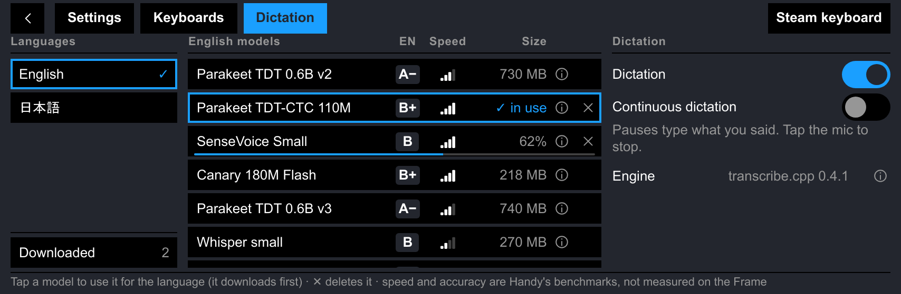

# Dictation

Speak instead of typing. Dictation is opt-in, and runs on the Frame's own CPU.

<!-- screenshot:  -->

Speech is recognized on the Frame, on its CPU, by [transcribe.cpp](https://github.com/handy-computer/transcribe.cpp); no audio leaves it. Dictation is off until you turn it on in settings → **Dictation**: nothing is downloaded or run before that, and the toolbar has no mic. Audio and transcripts stay in memory: they are never logged or written to disk. The journal gets status codes, model ids and durations only.

## Using it

- **Use:** press the mic key, speak, then press it again or pause for 0.6 s. While it listens, five bars on the key follow your voice; while the phrase is recognized, an arc circles inside its border (pressing it then gives up on the phrase). English is typed after what you were typing, spaced. On a Japanese keyboard the text goes into the reading for conversion, or is typed at once: that keyboard's **Dictation** option (Candidates, Type at once). In 英数 mode it is English. With no model for the keyboard's language, the mic opens the Dictation tab there.
- **Continuous dictation** (a switch on the Dictation tab): the mic listens until you press it again. Each pause types its phrase while you go on speaking, joined to the one before by a space where the script has them. It stops by itself after a minute without speech.
- **Models:** the Dictation tab lists your keyboards' languages and the models for each, with a speed and accuracy rating (from [Handy](https://github.com/cjpais/Handy)'s benchmarks on a laptop CPU, not measured on the Frame), the download size, and ⓘ for its languages, memory, licence and authors. Tap a model to use it for that language; it downloads first if needed. **Downloaded** lists what is on disk and which of your languages use it; ✕ deletes a model or stops its download. A language uses the model chosen for it, else a downloaded one made for it, else a downloaded Whisper (any language). While the engine, or the model a language waits for, downloads, the mic key is disabled with a progress track along its foot.

## How it works

- **Engine:** transcribe.cpp 0.4.1's prebuilt Linux aarch64 library from its GitHub release (18 MB), used through its own ctypes binding; nothing is compiled. Only the CPU libraries are installed (never `libggml-vulkan.so`: GPU inference on the Frame drew about 17 W and crashed, per TaiKeid); ggml picks the CPU variant the Frame supports. It runs in a helper process (`sidecar/polykey/speech/worker.py`) with 4 threads, in a systemd scope of its own capped for its model's memory (the service's `MemoryHigh=96M` would throttle it), started on the first phrase and stopped after 60 s unused or when another model is wanted.
- **Microphone:** `pw-record`, linked to the raw microphone where SteamOS's voice filters would mangle speech. The microphone sends silence while the headset is off your head; then dictation ends with `mic-silent`.
- **Downloads:** pinned in `sidecar/polykey/speech/catalog.json` by URL (or Hugging Face repo, revision and file), size and SHA-256; the engine only from github.com and the models only from Hugging Face, over HTTPS (redirects included). A download cut off by the network resumes where it stopped; a file is used only once its size and hash match.
- **Files:** `~/.local/share/polykey/speech/engine/0.4.1/` (`lib/`, `python/`, `licenses/`) and `speech/models/*.gguf`. `deploy.sh` leaves `speech/` alone.

## Models

| Model | Languages | Download | Licence |
|---|---|---|---|
| Whisper small | any (99) | 270 MB | Apache-2.0 (OpenAI) |
| Whisper base | any (99) | 85 MB | Apache-2.0 (OpenAI) |
| Parakeet TDT 0.6B v2 | en | 730 MB | CC BY 4.0 (NVIDIA) |
| Parakeet TDT-CTC 110M | en | 135 MB | CC BY 4.0 (NVIDIA) |
| SenseVoice Small | zh, yue, en, ja, ko | 253 MB | FunASR Model License 1.1 (Alibaba) |
| Canary 180M Flash | en, de, es, fr | 218 MB | CC BY 4.0 (NVIDIA) |
| Parakeet TDT 0.6B v3 | 25 European languages | 740 MB | CC BY 4.0 (NVIDIA) |

All are 8-bit GGUF conversions by handy-computer on Hugging Face. Their full attributions (also in `sidecar/polykey/speech/catalog.json`):

- Whisper small: Whisper small by OpenAI (Apache-2.0), converted to GGUF and quantized to 8 bits by handy-computer.
- Whisper base: Whisper base by OpenAI (Apache-2.0), converted to GGUF and quantized to 8 bits by handy-computer.
- Parakeet TDT 0.6B v2: parakeet-tdt-0.6b-v2 by NVIDIA, CC BY 4.0, https://creativecommons.org/licenses/by/4.0/; converted to GGUF and quantized to 8 bits by handy-computer.
- Parakeet TDT-CTC 110M: parakeet-tdt_ctc-110m by NVIDIA, CC BY 4.0, https://creativecommons.org/licenses/by/4.0/; converted to GGUF and quantized to 8 bits by handy-computer.
- SenseVoice Small: SenseVoiceSmall by FunAudioLLM (Alibaba Group), FunASR Model License 1.1, https://github.com/modelscope/FunASR/blob/main/MODEL_LICENSE; converted to GGUF and quantized to 8 bits by handy-computer.
- Canary 180M Flash: canary-180m-flash by NVIDIA, CC BY 4.0, https://creativecommons.org/licenses/by/4.0/; converted to GGUF and quantized to 8 bits by handy-computer.
- Parakeet TDT 0.6B v3: parakeet-tdt-0.6b-v3 by NVIDIA, CC BY 4.0, https://creativecommons.org/licenses/by/4.0/; converted to GGUF and quantized to 8 bits by handy-computer.

## Check the engine

Do this once on the Frame, after the engine and Whisper small have downloaded. It prints which ggml CPU variant it loaded, then the JFK quote ("And so my fellow Americans, ask not…") within a few seconds; random words mean that CPU variant computes wrongly (see [Troubleshooting](#troubleshooting)):

```sh
cd ~/.local/share/polykey/speech
curl -sLO https://raw.githubusercontent.com/ggml-org/whisper.cpp/d1be6fde11ac6e0407606b4e42fe72d34add8037/samples/jfk.wav
python3 -I ~/.local/share/polykey/current/sidecar/polykey/speech/worker.py engine/0.4.1 models/whisper-small-Q8_0.gguf 4 --check jfk.wav
```

## Troubleshooting

If the check prints garbage, move the newest CPU variants aside so ggml falls back to an older one (`mkdir -p engine/off && mv engine/0.4.1/lib/libggml-cpu-armv9.2_* engine/0.4.1/lib/libggml-cpu-armv8.6_* engine/off/`) and run the check again (code built with i8mm has produced garbage on the Frame; armv8.2 with dot product works). The journal's "speech helper loaded (…, cpu …)" line names the variant in use. Status codes: `no-engine`, `no-model`, `engine-failed`, `model-failed`, `no-recorder`, `no-microphone`, `no-speech`, `mic-silent`, `helper-failed`, `helper-timeout`, and for downloads `network`, `bad-hash`, `bad-size`, `bad-host`, `bad-archive`, `unsupported`, `no-space`.
