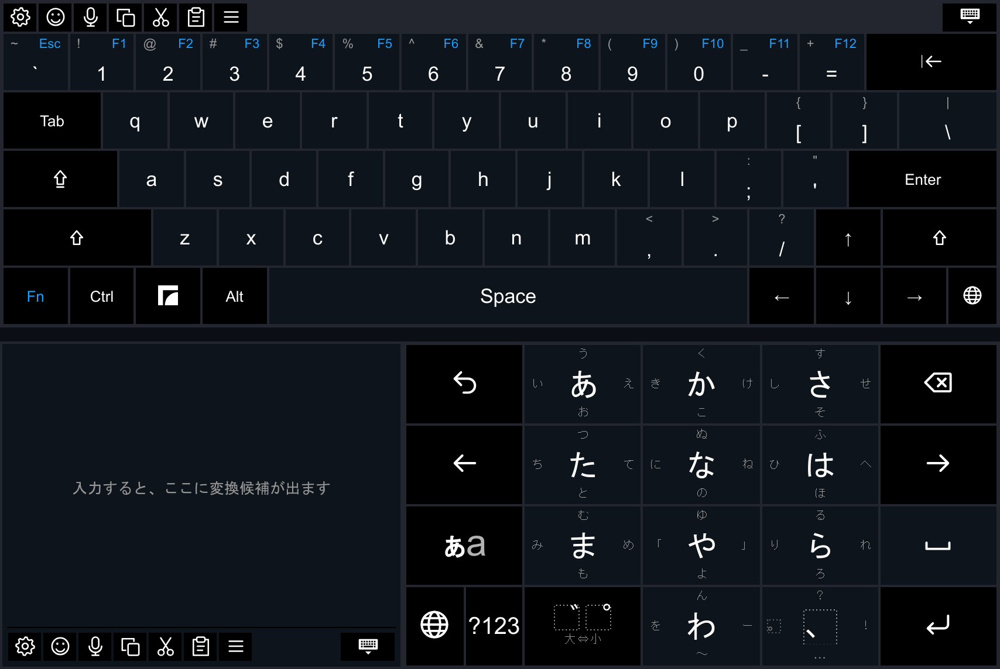
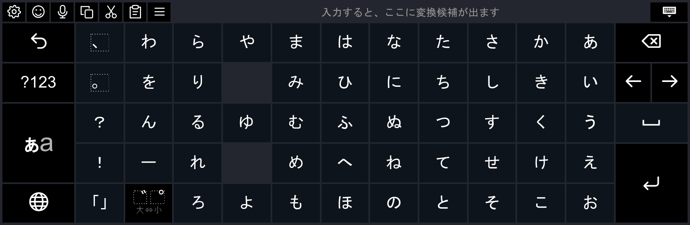
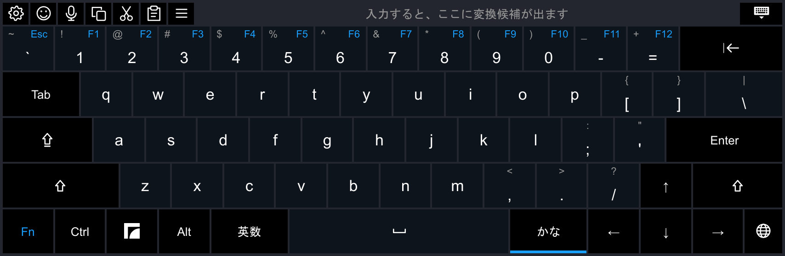
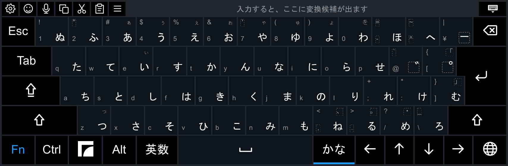

# Keyboards

What polykey's English, Japanese and Korean keyboards do, and the toolbar and emoji they share.

## English

- **Keys:** the number row with an Fn layer (Esc, F1–F12), sticky Ctrl, Alt, Frame (Super) and Fn, and full arrows. Hold a key for its alternates.
- **Word suggestions** from a bundled word list, with spelling corrections (helo → hello, teh → the) ranked alongside completions. The method follows frame-jp-keyboard (MIT).

## Swipe typing

Hold the trigger and trace a word across the letters. The best word is typed, with a space before it when it follows a word; two alternatives show beside it in the bar, and picking one replaces it. Backspace right after a swipe takes the word back. The sidecar decodes the path by template matching against the word list of the mode you are in, so any keyboard pack that declares `"features": {"swipe": {}}` can swipe. It is off by default: Settings → Swipe typing turns it on, per keyboard. The Japanese keyboards offer it for English in 英数 mode (the 12-key's QWERTY ABC page, romaji, JIS), where the swiped word waits in the bar like a typed one.

## Japanese

Four keyboards type into a reading buffer, converted with Anthy (SteamOS's libanthy), which learns from what you send.

### 12-key

Flick input, shown at the top of this page. Options, worded as in Gboard: 英字入力はQWERTY (ABC mode as QWERTY or flick letters), フリックのみ (off: tapping a key again steps to its next kana), フリックガイドを表示 (flick hints), 候補を左に表示 (candidates on the left, the default).

### 五十音

The 50-sound table as keys, read right to left like Gboard's 五十音 layout; tap a kana, ゛゜小 changes the one before. Shares the 12-key's letter and symbol pages.

### Romaji

The English layout with 英数 and かな beside Space; in かな, letters become kana as you type (ka → か), and `, . - [ ]` become 、。ー「」.

### Kana (JIS)

The JIS layout, Mac style. Each key has its Latin and kana legends: 英数 types the Latin ones, かな the kana (Shift: the upper legend). ゛ and ゜ join the kana before them. Option: ローマ字入力, where the keys type their Latin legends as romaji. かな while typing shows the reading as カタカナ, then ﾊﾝｶｸ (on the romaji keyboard too).

### English on the Japanese keyboards

In 英数 (ABC) mode the word waits in the bar like a kana reading, with up to eight suggestions where the candidates go. Space or punctuation sends it, 確定 sends it alone, and a picked suggestion replaces it.

## Korean

The standard 2-set (두벌식) layout: consonants on the left, vowels on the right, at the QWERTY positions. Shift gives the tense consonants ㅃ ㅉ ㄸ ㄲ ㅆ and ㅒ ㅖ.

- **Composing in the field:** in Steam and in games, the syllable you are typing goes into the text field and changes there with each jamo (ㅎ, 하, 한), as on Steam's own keyboard; the bar shows only suggestions. Once the next jamo cannot join it, it stays, and the next syllable begins (한 + ㄱ → 한ㄱ). Vowels and finals that combine do (ㅗ + ㅏ → ㅘ, ㄹ + ㄱ → ㄺ), and a vowel after a final takes that consonant into the next syllable (한 + ㅏ → 하나). polykey only ever retypes the syllable it is composing: Space, any other key, a click in the field, another field and closing the keyboard all leave it as it is.
- **Composing in the bar:** where polykey cannot compose in the field (Desktop Mode, where it types by pasting, and streaming), the whole word is built in the bar and goes into the field at once: Space sends it with a space, and Enter sends it without pressing Enter (so it never starts a search); with the bar empty, Enter is Enter.
- **Word suggestions:** whole words with their particles and endings, from a Korean word list, where the candidates go. They match the keys you type, so 하 already offers 한국, and 학교 offers 학교에서 and 학교를. Picking one replaces the word: the syllables already typed stay as far as it starts with them, the rest are deleted (in the bar nothing was sent, so nothing is), and the rest of the word goes in with a space. Words you use come first for the rest of the session.
- **⌫** takes the last jamo off (닭 → 달 → 다 → ㄷ), then, in the bar, the word's syllables; with nothing being composed it deletes in the field.
- **Space, Enter and punctuation** send the syllable (in the bar, the word) first, as do 한/영, 🌐 and dictation.
- **한자**, left of Space, converts a word in the one you are typing to Hanja: the longest word with Hanja in it, so 학교에서 offers 學校 for 학교 (of words as long, the one nearest the caret). The text stays as it is while the bar shows the Hanja, each with its meaning beneath where the dictionary gives one (韓: 나라 이름 한), and 한자 shows the mode's mark. Space (다음) goes on to the next, ← and → go to the word with Hanja before or after it, and Enter or a tap picks one: polykey deletes back to the word's start, only ever syllables it typed, then types the Hanja and what followed it (學校에서), the syllable you are composing still being composed. In the bar, it replaces them there. 한자 again closes it with the text as it was, as ⌫ does; typing on, another field or the keyboard closing do too, and nothing but a picked Hanja is ever typed. Your pick comes first for that word from then on. The Hanja come from SteamOS's own dictionary (libhangul's, installed with ibus-hangul); without it 한자 does nothing, and the journal says so once. In ABC it does nothing.
- **한/영**, right of Space, switches to ABC: the English layout, where words wait in the bar with suggestions and swipe typing works, as in the Japanese keyboards' 英数 mode. 한/영 again goes back. The bar under 한 or 영 shows which mode you are in, as 英数 and かな do.
- **Swipe typing**, once on, works in 한글 too: a word goes through its jamo's keys as you would type them, a compound through both of its (과: ㄱ ㅗ ㅏ), and ㅃ and the other Shift letters through their own key (빨리: ㅂ ㅏ ㄹ ㅣ, a doubled key once). The syllable being composed is sent first; then the word goes in as in English, its alternatives where the candidates go. It knows the list's 60,000 most common words.

## Toolbar

Settings (theme, haptics, suggestions, updates and the keyboard's own options; keyboards; dictation), emoji, dictate (while dictation is on), copy, cut, paste, menu (the context menu, as Shift+F10) and ✕, which closes the keyboard.

## Emoji

Recent, Favorites (drag and drop), skin tones, and your Steam emoticons, stickers and room effects.

The `:-)` key on the picker's bottom row switches to kaomoji, text faces like (＾▽＾), in categories with their own Recent; the same key switches back. The picker opens on the set you used last. Emoji and kaomoji are picker sets, and you can add your own: see [PACKS.md](PACKS.md#a-picker-set).

## Switching keyboards

🌐 switches between polykey's keyboards; hold it to jump to one. Settings → Keyboards picks them and their order. **Steam keyboard** in settings hands over to Steam's own keyboard.

## Desktop Mode

KDE Desktop Mode gets non-ASCII text by paste.
