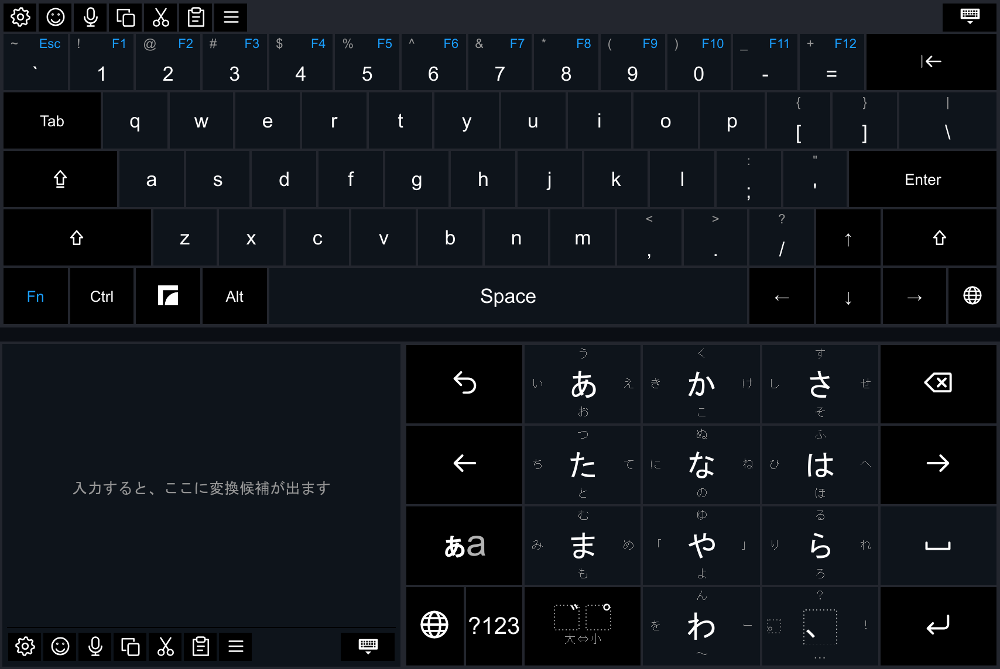
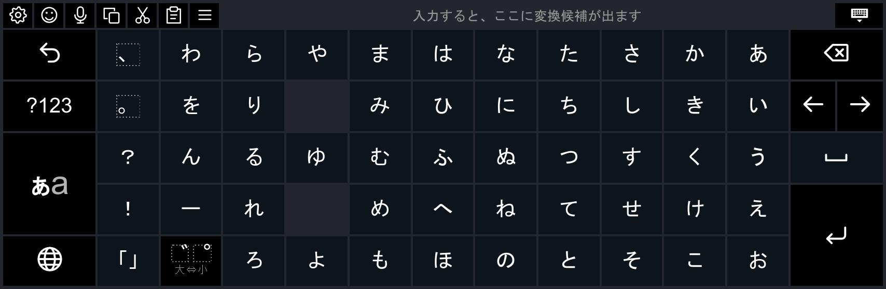
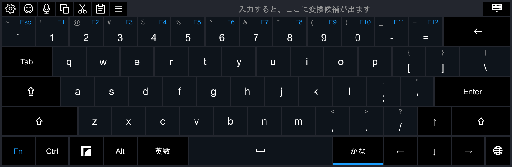
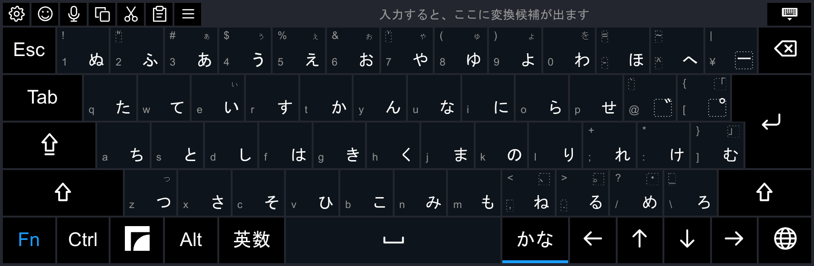

# Keyboards

What polykey's English and Japanese keyboards do, and the toolbar and emoji they share.

## English

- **Keys:** the number row with an Fn layer (Esc, F1–F12), sticky Ctrl, Alt, Frame (Super) and Fn, and full arrows. Hold a key for its alternates.
- **Word suggestions** from a bundled word list, with spelling corrections (helo → hello, teh → the) ranked alongside completions. The method follows frame-jp-keyboard (MIT).

## Swipe typing

Hold the trigger and trace a word across the letters. The best word is typed, with a space before it when it follows a word; two alternatives show beside it in the bar, and picking one replaces it. Backspace right after a swipe takes the word back. The sidecar decodes the path by template matching against the word list, so any layout pack that declares `"features": {"swipe": {"lexicon": …}}` can swipe. It is off by default: Settings → Swipe typing turns it on, per keyboard. The Japanese keyboards offer it for English in 英数 mode (the 12-key's QWERTY ABC page, romaji, JIS), where the swiped word waits in the bar like a typed one.

## Japanese

Four keyboards type into a reading buffer, converted with Anthy (SteamOS's libanthy), which learns from what you send.

### 12-key

Flick input, shown at the top of this page. Options, worded as in Gboard: 英字入力はQWERTY (ABC mode as QWERTY or flick letters), フリックのみ (off: tapping a key again steps to its next kana), フリックガイドを表示 (flick hints), 候補を左に表示 (candidates on the left, the default).

### 五十音

The 50-sound table as keys, read right to left like Gboard's 五十音 layout; tap a kana, ゛゜小 changes the one before. Shares the 12-key's letter and symbol pages.

### Romaji

The English layout with 英数 and かな beside Space; in かな, letters become kana as you type (ka → か), and `, . - [ ]` become 、。ー「」.

### Kana (JIS)

The JIS layout, Mac style. Each key has its Latin and kana legends: 英数 types the Latin ones, かな the kana (Shift: the upper legend). ゛ and ゜ join the kana before them. Option: ローマ字入力, where the keys type their Latin legends as romaji. かな while typing shows the reading as カタカナ, then ﾊﾝｶｸ (on the romaji keyboard too).

### English on the Japanese keyboards

In 英数 (ABC) mode the word waits in the bar like a kana reading, with up to eight suggestions where the candidates go. Space or punctuation sends it, 確定 sends it alone, and a picked suggestion replaces it.

## Toolbar

Settings (theme, haptics, suggestions, updates and the keyboard's own options; keyboards; dictation), emoji, dictate (while dictation is on), copy, cut, paste, menu (the context menu, as Shift+F10) and ✕, which closes the keyboard.

## Emoji

Recent, Favorites (drag and drop), skin tones, and your Steam emoticons, stickers and room effects.

The `:-)` key on the picker's bottom row switches to kaomoji, text faces like (＾▽＾), in categories with their own Recent; the same key switches back. The picker opens in the mode you used last.

## Switching keyboards

🌐 switches between polykey's keyboards; hold it to jump to one. Settings → Keyboards picks them and their order. **Steam keyboard** in settings hands over to Steam's own keyboard.

## Desktop Mode

KDE Desktop Mode gets non-ASCII text by paste.
